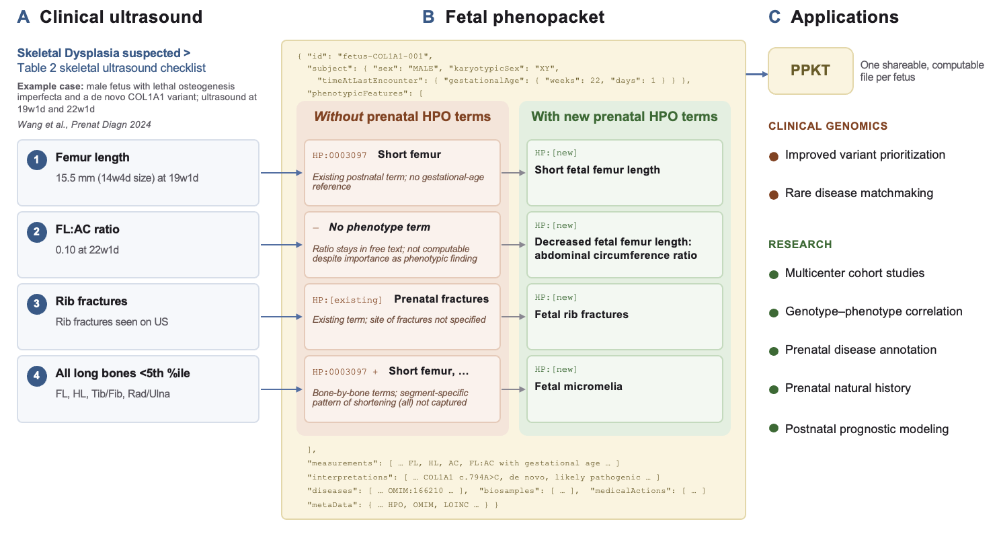

[](docs/)
[](LICENSE)
[](https://github.com/phenopackets)
[](https://hpo.jax.org/)

# prenatalppkt

`prenatalppkt` is a Python library for transforming prenatal ultrasound data into
standardized [GA4GH Phenopackets v2](https://phenopacket-schema.readthedocs.io/).
It works with fetal biometry, HPO terms, and fetal growth references such as
NICHD and INTERGROWTH-21st.

## Table of Contents

1. [Overview](#overview)
2. [Motivation](#motivation)
3. [Installation](#installation)
4. [Usage Examples](#usage-examples)
5. [Testing](#testing)
6. [Contributing](#contributing)
7. [License](#license)
8. [Acknowledgments](#acknowledgments)
9. [Citation](#citation)
10. [Support](#support)

## Overview

Prenatal ultrasound reports contain clinical measurements such as head
circumference, abdominal circumference, biparietal diameter, femur length, and
estimated fetal weight. `prenatalppkt` helps turn those measurements and related
report text into structured data that other clinical and genomics tools can
understand.

At a high level, the package helps with:

- parsing prenatal ultrasound exports
- preserving gestational-age context
- mapping biometry results to HPO terms
- representing normal findings as excluded Phenopacket features
- building GA4GH Phenopacket v2 objects

Detailed setup, data, architecture, and API notes live in the documentation under
[`docs/`](docs/).



The figure shows the idea with prenatal skeletal findings: each ultrasound finding becomes a coded HPO term in one Phenopacket per fetus, next to its measurements, variant interpretation and diagnosis. More figures are in [`docs/prenatal-skeletal-terms.md`](docs/prenatal-skeletal-terms.md).

## Motivation

Prenatal ultrasound data is clinically useful, but it is often stored in formats
that are hard to reuse across projects or institutions. The same clinical idea
can appear as a raw number, a percentile, a short label, or a sentence in a
report.

`prenatalppkt` aims to make that data easier to use by converting prenatal
findings into a standard Phenopacket representation with ontology-backed terms.
This makes the data easier to test, share, compare, and connect with genomic
interpretation workflows.

## Installation

### Prerequisites

- Python 3.10 or higher
- [uv](https://docs.astral.sh/uv/) or a standard Python virtual environment

### Quickstart with uv

```bash
git clone https://github.com/P2GX/prenatalppkt.git
cd prenatalppkt
uv sync --extra dev
uv run python -c "import prenatalppkt; print(prenatalppkt.__version__)"
```

### Alternative with venv and pip

```bash
uv sync --extra dev --extra ocr
```

### Alternative: pip + venv

For users who cannot or prefer not to install uv:

```bash
# Clone and enter the repo

git clone https://github.com/P2GX/prenatalppkt.git
cd prenatalppkt

python3 -m venv .venv
source .venv/bin/activate
pip install -e ".[dev]"

python -c "import prenatalppkt; print(prenatalppkt.__version__)"
```

### Installation Notes:

**VSCode / VSCodium notebook users:** `ipykernel` is included in the `dev` extra,
but auto-detection is unreliable - `uv sync` can register a kernelspec whose
`argv` is just `"python"` instead of the venv's absolute interpreter path, which
resolves against whatever `python` happens to be on `PATH` at kernel-launch time
and fails with `ModuleNotFoundError: No module named 'google'` (or similar) if
that's not this venv. If notebook cells fail to import project dependencies, try:

```bash
uv run python -m ipykernel install --user --name=prenatalppkt-venv \
    --display-name="prenatalppkt (.venv)"
```

Then reload the editor window and select **"prenatalppkt (.venv)"** as the
notebook's kernel. If that kernel doesn't appear after reloading, select the
interpreter directly instead: "Select Another Kernel" → "Python Environments" →
the `.venv/bin/python3` inside this repo.

**Environment variables in a notebook kernel:** a kernel started by
VSCode/VSCodium does not inherit variables `export`ed in a terminal - it
starts from the editor's own environment, not a shell that sourced your
`~/.bashrc`/`~/.zshrc`. If a notebook needs an environment variable set, put
it in a `.env` file at the repo root (already gitignored). **Don't rely on
the editor to inject it automatically** - the Python extension's
`python.envFile` setting only applies to kernels it launches through its
own interpreter tracking; a kernel registered standalone via `ipykernel
install` (the command above) is launched directly via its own `kernel.json`
`argv` and never sees it, confirmed by this failing even with a
correctly-populated `.env` and the right kernel selected. Instead, have the
notebook's first cell read `.env` itself with a small stdlib-only loader
(no new dependency needed) before checking `os.environ` - that works
regardless of which frontend or kernel-launch mechanism is involved.

VSCodium's Jupyter extension has also been observed rewriting a notebook's
`metadata.kernelspec` back to a generic `{"name": "python3", "display_name":
".venv"}` on save, even when it ran under the correctly-named kernel - if a
notebook's kernel keeps needing to be re-selected, check whether a prior
save reset this and re-pin it in the `.ipynb` JSON before committing.

**hp.json:** The repo root may contain `hp.json`, a version-pinned HPO ontology snapshot
used by tests. Do not delete or re-download it unless intentionally updating the
ontology version — it is pinned for reproducibility.

### Build the docs locally

```bash
uv pip install -e ".[docs]"
.venv/bin/sphinx-build -b html docs docs/_build/html
```

Then open:

```text
docs/_build/html/index.html
```

## Usage Examples

### Build Phenopackets from Observer JSON

The test HPO fixture is stored as `hp.json.gz` to keep the repository smaller.
This example decompresses it to a temporary `hp.json` file because `HpoParser`
expects a normal JSON file path.

```python
import gzip
import json
from datetime import datetime, timezone
from pathlib import Path

from google.protobuf.timestamp_pb2 import Timestamp

from prenatalppkt.builders import build_observer_phenopacket
from prenatalppkt.hpo import HpoParser

observer_data = json.loads(Path("tests/data/Apple_Sally_pretty.json").read_text())

hp_json = Path("/tmp/prenatalppkt-hp.json")
with gzip.open("tests/data/hp.json.gz", "rt", encoding="utf-8") as src:
    hp_json.write_text(src.read(), encoding="utf-8")

hpo_parser = HpoParser(hpo_json_file=str(hp_json))

created = Timestamp()
created.FromDatetime(datetime.now(timezone.utc))

phenopackets = build_observer_phenopacket(
    observer_data,
    hpo_parser,
    created,
    accession_id="example-accession",
)
```

### Extract Observer biometry only

```python
import json
from pathlib import Path

from prenatalppkt.etl.extractors import observer

data = json.loads(Path("tests/data/Apple_Sally_pretty.json").read_text())
term_bins = observer.extract(data)

for term_bin in term_bins:
    print(term_bin.description, term_bin.hpo_id, term_bin.hpo_label)
```

For more examples, see [`docs/setup.md`](docs/setup.md) and the notebook
`prenatalppkt.ipynb`.

## Testing

Run the full test suite:

```bash
uv run pytest
```

Run a focused test:

```bash
uv run pytest tests/builders/test_observer_phenopacket.py
```

Run linting and formatting:

```bash
uv run ruff check src/ tests/
uv run ruff format src/ tests/
```

## Contributing

Create a focused branch, make a small change, run the relevant tests, and open a
pull request.

```bash
git checkout -b vj/my-change
uv sync --extra dev
uv run pre-commit install
uv run pytest
git add README.md
git commit -m "docs: clean readme"
git push -u origin vj/my-change
```

Do not bypass pre-commit hooks. If a hook fails, fix the issue and make a new
commit.

## License

This project uses a dual-license model:

- AGPL-3.0-only for open-source use.
- Commercial license available by separate written agreement.

See [LICENSE](LICENSE) and [COMMERCIAL-LICENSE.md](COMMERCIAL-LICENSE.md).

Copyright (c) 2025-present Varenya Jain.

## Acknowledgments

Reference standards:

- NICHD Fetal Growth Studies
- INTERGROWTH-21st Project

Contributors:

- [Varenya Jain](https://orcid.org/0009-0000-4429-6024)
- [Peter N. Robinson](https://orcid.org/0000-0002-0736-9199)

## Citation

If you use `prenatalppkt`, cite the repository and the relevant fetal growth
reference standard.

```tex
@software{prenatalppkt,
  author = {Jain, Varenya and Robinson, Peter N.},
  title = {prenatalppkt: Standardized Prenatal Phenotype Representation},
  year = {2025},
  url = {https://github.com/P2GX/prenatalppkt}
}
```

## Support

- Documentation: [`docs/`](docs/)
- Issues: <https://github.com/P2GX/prenatalppkt/issues>
- Discussions: <https://github.com/P2GX/prenatalppkt/discussions>
