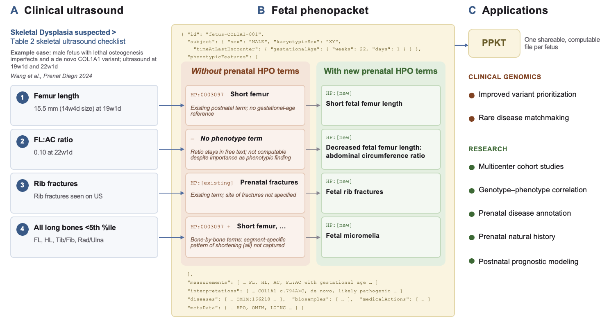
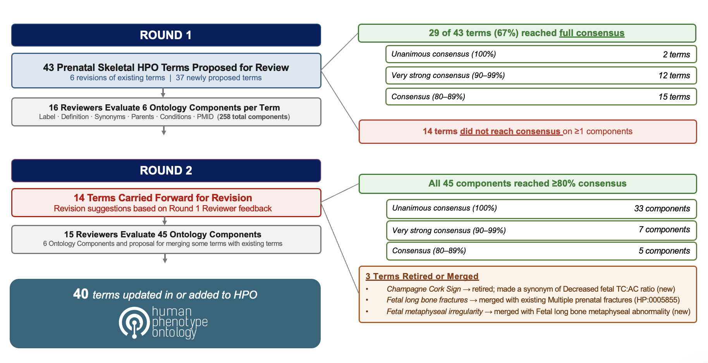
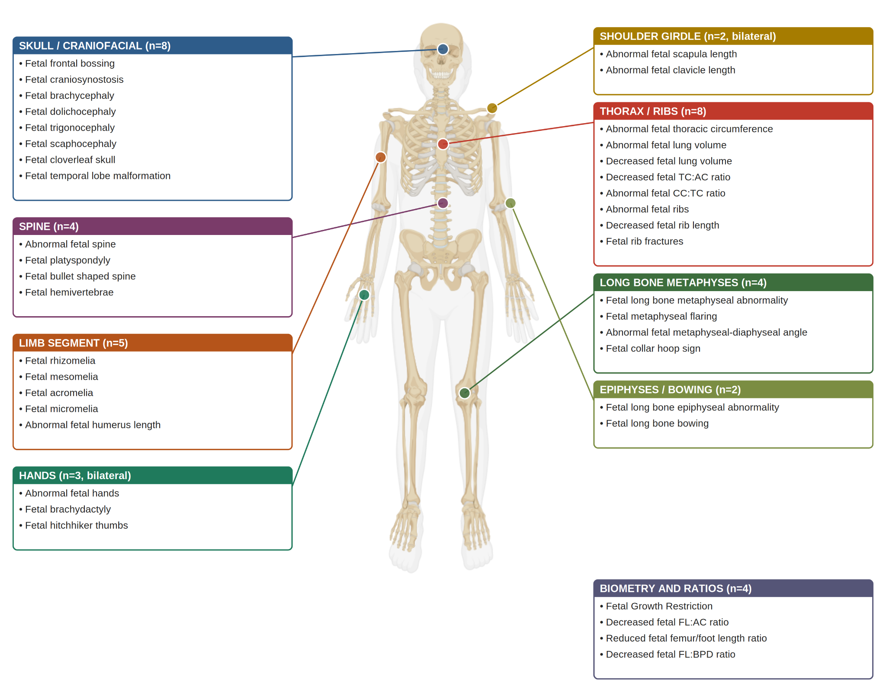

# Prenatal skeletal terms and the fetal Phenopacket

These figures show how `prenatalppkt` uses HPO terms written for findings that are seen before birth, using prenatal skeletal dysplasia as the example.

## From an ultrasound finding to a fetal Phenopacket

A suspected skeletal dysplasia produces findings such as femur length, a femur-to-abdominal-circumference ratio, rib fractures and short long bones. Without prenatal HPO terms, some findings get a postnatal term with no gestational-age context, and some stay in free text. With prenatal terms, each finding becomes a coded phenotypic feature in one Phenopacket per fetus, next to its measurements (with gestational age), the variant interpretation, the diagnosis and the metadata. That one file can then serve variant prioritisation, matchmaking, cohort studies and genotype-phenotype work.

## How the prenatal skeletal terms were agreed

The prenatal skeletal terms were agreed in a two-round expert review (a modified e-Delphi). Each term had six parts reviewed: label, definition, synonyms, parents, conditions and a supporting reference.

## The terms by body region

The terms cover the skull and face, spine, limb segments, hands, shoulder girdle, thorax and ribs, long-bone metaphyses and epiphyses, and biometry ratios. The term IDs will be listed here when they are released in HPO.
